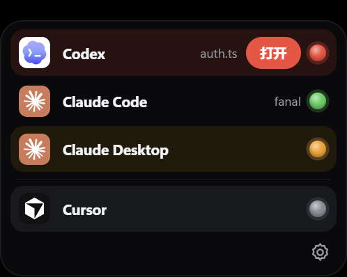
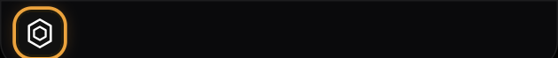
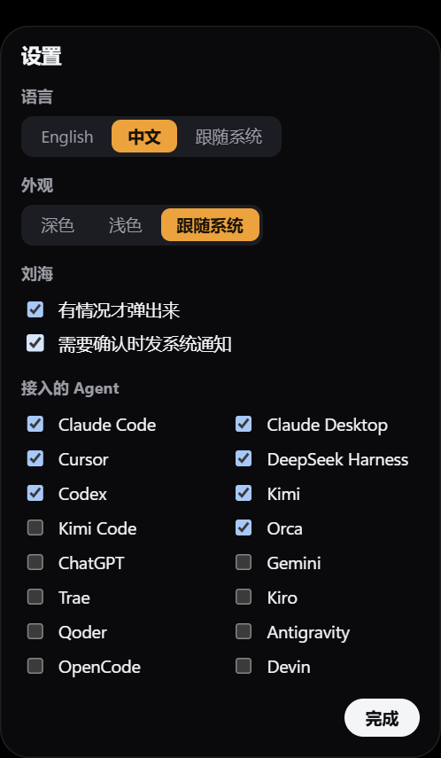

# Fanal

Fanal is the system-wide task monitor for the coding agents on this machine.

Each agent keeps its own window. A task may be executing, stopped and waiting for a confirmation, or the program may not be running at all, and that state is scattered across those windows. Fanal stands at the level of the system and gathers it into one notch on the top edge of the screen: which agent is working, which one is waiting on you, and which one has not been started.

The notch speaks with a lamp, and the colour is the whole message. Grey means the program is not running. Yellow means the client is open and no task is executing. Green means a task is executing. Red means a task has opened a confirmation and needs you. Red outranks green, green outranks yellow, and yellow outranks grey.

[中文说明](README.zh-CN.md)

At rest the notch is a small black lip, and the window is only as tall as that lip, so it does not cover the browser tabs underneath. It opens on its own when an agent needs you or a task that was running has stopped, and it opens fully while the pointer is over it. It closes as soon as the pointer leaves, and also when you click somewhere else. Clicking a row brings that agent's own window to the front, maximised. Fanal never answers a prompt for you.



The notch at rest, and the same notch after it opened itself because Codex is waiting on `auth.ts`:




## Settings

The gear at the bottom of the panel opens settings: which agents are watched, whether the notch opens by itself, and the language and theme. Settings are kept in `%APPDATA%\Fanal\settings.json`, which is Fanal's own directory and never an agent's.



A lamp in the tray follows the most urgent colour on the board. Red outranks green, green outranks yellow, yellow outranks grey.

## What it watches

The monitor covers the coding agents on the system, not the conversation inside a single window.

Claude Code, Claude Desktop, Cursor, DeepSeek Harness, Codex, Kimi, Kimi Code, Gemini, Trae, Kiro, Qoder, Antigravity, OpenCode, and Devin. The Codex app and the ChatGPT desktop app are the same program, so they share one lamp.

Every agent is detected from its process. Claude Code, Claude Desktop, Codex, Kimi, and Kimi Code also have a session file whose format was checked against real files, so those five can say what they are doing rather than only that they are running. The details, including what Fanal refuses to read out of a session file, are in [docs/AGENTS.md](docs/AGENTS.md).

## Build

Fanal is a [Tauri](https://tauri.app) 2 application. The window and the panel are Rust plus a small page with no build step; the decision about which colour a lamp gets is a separate crate, `fanal-core`, with no dependencies beyond serde, so it can be tested on its own.

```
cargo test --manifest-path fanal-core/Cargo.toml
cargo build --manifest-path src-tauri/Cargo.toml
```

The debug build is `src-tauri/target/debug/fanal.exe`. An installer is produced with `cargo tauri build` from `src-tauri`, which needs the [Tauri prerequisites](https://tauri.app/start/prerequisites/) and WebView2.

Rust 1.90 or newer. The panel is Windows only; `fanal-core` is not.

## Layout

```
fanal-core/     lamp decisions and session parsers, with their tests
src-tauri/      the desktop app: process scan, window focus, tray
ui/             the panel: one page, one stylesheet, one script
docs/           how detection works, and the screenshots above
AGENTS.md       rules for working on this repo
CHANGELOG.md    what a person can do after each release
```

[AGENTS.md](AGENTS.md) is the working agreement. [docs/AGENTS.md](docs/AGENTS.md) is a different file: it describes how a lamp is read.

## License

[MIT](LICENSE)
