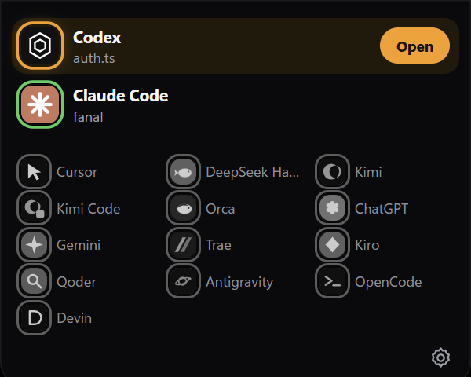
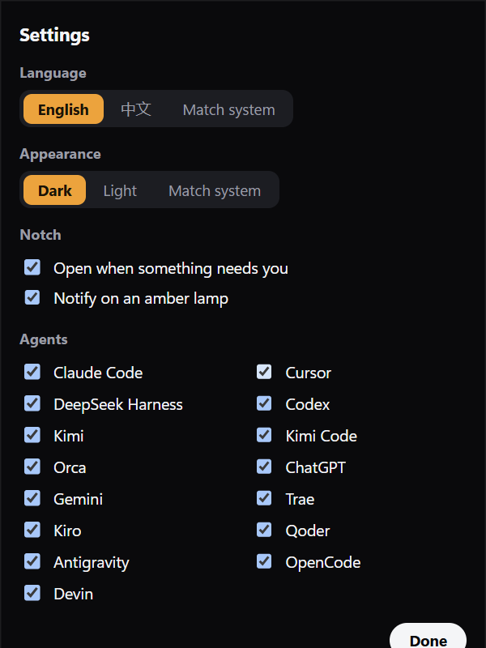

# Fanal 号灯

一条贴在屏幕最上方的刘海，为本机上的每一个编程 Agent 亮一盏灯。绿色是正在工作，黄色是停在了只有你能回答的地方，红色是没有在跑。没有状态文字，颜色就是全部的意思。

[English](README.md)

平时它只是一小条黑色的边。某个 Agent 需要你，或者一个正在跑的任务停了下来，它会自己弹开；鼠标放上去时它会完全展开。鼠标短暂离开不会让它收回去。点击一行，会把那个 Agent 自己的窗口调到前台并最大化。Fanal 不会替你回答任何提示。



收起时的刘海，以及 Codex 停在 `auth.ts` 上之后它自己弹开的样子：


## 设置

面板底部的齿轮打开设置：监视哪些 Agent、刘海要不要自己弹开、黄灯时要不要发一条 Windows 通知，以及语言和主题。设置保存在 `%APPDATA%\Fanal\settings.json`，这是 Fanal 自己的目录，不是任何一个 Agent 的。



托盘里的灯跟着整块面板上最严重的颜色走。黄灯优先于绿灯，绿灯优先于红灯。

## 它监视哪些

Claude Code、Cursor、DeepSeek Harness、Codex、Kimi、Kimi Code、Orca、ChatGPT、Gemini、Trae、Kiro、Qoder、Antigravity、OpenCode 和 Devin。

每个 Agent 都从进程判断。Claude Code、Codex 和 Kimi Code 另外有一份拿真实文件核过格式的会话文件，所以这三个能说出自己在做什么，而不只是在不在跑。细节，包括 Fanal 拒绝从会话文件里读什么，写在 [docs/agents.zh-CN.md](docs/agents.zh-CN.md)。

## 构建

Fanal 是一个 [Tauri](https://tauri.app) 2 应用。窗口和面板是 Rust 加上一个没有构建步骤的小页面；灯该是什么颜色这个判断单独放在 `fanal-core` 里，除了 serde 没有别的依赖，所以可以单独测试。

```
cargo test --manifest-path fanal-core/Cargo.toml
cargo build --manifest-path src-tauri/Cargo.toml
```

调试版在 `src-tauri/target/debug/fanal.exe`。在 `src-tauri` 里运行 `cargo tauri build` 会打出安装包，需要 [Tauri 的先决条件](https://tauri.app/start/prerequisites/) 和 WebView2。

需要 Rust 1.90 或更新的版本。面板只在 Windows 上运行，`fanal-core` 不限平台。

## 目录

```
fanal-core/     灯的判断和会话解析，以及对应的测试
src-tauri/      桌面应用：进程扫描、窗口聚焦、托盘、通知
ui/             面板：一个页面、一份样式、一段脚本
docs/           检测方式的说明，以及上面这些截图
```

## 许可证

[MIT](LICENSE)
